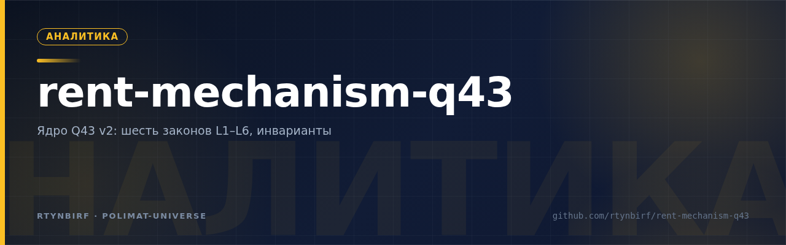

<div align="center">
  
</div>

# РЕНТНЫЙ МЕХАНИЗМ — ПРОГРАММА R11–R49

**Статус: SOLVED_WITH_CAVEATS.** Ядро Q43 v2, шесть законов L1–L6, инвариант I_K″.
Метод: реальность → наблюдаемые элементы → связи → операции → воспроизводство → механизм → формализация. Протокол HYPOTHESIS → TASK GRAPH → EVIDENCE → ATTACK → UPDATE. **UNKNOWN ≠ FALSE.**

**Реестр caveats (Волна ×4 · П48):** каждый caveat = запись с формулой приёмки — `docs/CAVEATS.md` + `results/caveats_registry.json` (22 записи, счётчик машиносчётом: `python3 scripts/caveat_registry.py check`). Ядро → SOLVED только при caveats_open=0; явный трекинг долга вместо автозакрытия.

---

## Структура

```
docs/
  FINALNIY_PROMPT_V8.0_INTEGRATSIYA_YADRA.md   # канон: ядро, законы, инвариант, честный лист
  R11_RENT_MECHANISM_VERDICT.md                # первый машинный вердикт программы
  R20_COUNTERFACTUAL_ATTACK_VERDICT.md         # контрфактическая атака, якорь-критерий ренты
  META_PROMPT_RESEARCH_DISPATCHER_V2.md        # контур управления исследованием: уровни L0–L20
  META_PROMPT_EMERGENCE_PROOF.md                # пруф эмерджентности контура L0–L20: Бедо/Андерсон
results/                                       # машинные реестры (JSON, воспроизводимые)
  r11 r20 r32 r33 r40 r42 r43 r44e r44f r46e r48 r49
findings/                                      # полевые находки R44–R47 (13 файлов)
scripts/                                       # прогоны: наблюдение, атака, консолидация, свод
worklog.md                                     # журнал программы: Task ID 1–12, все вердикты
```

## Ядро (кратко)

Состояние: `Q43 = (S, Ah, X, F, B, C, N, G, W, P, M, I)`.
Оператор: `Φ42(Q_t; R_t, N_t, G_t, W_t)`. Цена места:
`V_t = Σ E[R_s | модель шока]/(1+r)^s × Prob(survival)`.

- **MIN-SET = {K1, K2}** — предел множества носителей + исполняемое исключение; строго необходимы (11/11 выживших случаев, машинно).
- **Каналы воспроизводства** `K = {K_f, K_w, K_s, K_t}` — отказы попарно различны (R44-f).
- **Инвариант I_K″** (патч цикловой формулы): `∃Q,∃t*: R_{t*}>0 ∧ Q_{t+1}=Φ42(...) ∧ вход ∈ {R_t, резервы, донор} ∧ множество носителей замкнуто`; фальсифицируем по N9.

## Шесть законов (машинно проверены)

1. **Серое зеркало** — при K1∧K2∧R>0 цена места есть в каком-то режиме (легальном или теневом); без K1 — нигде (r48, 5/5).
2. **Доноры** — цена спасения: D0=$0 (правило) < D4=$350M (кредитор) < D2≥$471M (налогоплательщик) < D1=$2.9B (резервы = терминально); класс меняется только через D2/D3 (r46e M2).
3. **Паразитарность** — класс взаимодействия слоя с источником определяет ТИП КАПА; НЕКРО пуст (r44d).
4. **FR6-условный** — |ΔP|>|ΔF| только при режимных шоках; повторяющиеся запрайсены (NYC 0.89–0.95 vs 0.4–0.5; MDB 0.14 vs 2.35).
5. **Дисконт W_lat** — дисконт ≈ p·(1−c)·V (ЮКОС −36…−69%; Зимбабве c≈0; США c≈1).
6. **FLIP-пара** — NYC (слой против заместителя при шоке) ↔ Дублин-2000 (снятие слоя до шока → рассеяние через вход, парк ×4.3).

## Воспроизведение

```bash
python3 scripts/r49_integration.py   # единый свод: должен напечатать verdict INTEGRATED
cat results/r49_results.json         # реестр прогонов + перекрёстные проверки + UNKNOWN
```

Отдельные прогоны: `r42_discovery.py` (наблюдение 6×6), `r44f_invariant_attack.py`
(цикловая формула), `r46e_consolidation.py` (M1/M2/M3), `r48_gray_mirror.py` (закон серого зеркала).

## Границы

- Все числа — из локальных артефактов `results/` и `findings/`; чего нет — UNKNOWN (реестр: 22 позиции в `results/r49_results.json`).
- Исследование наблюдательное: ни один вывод не является инвестиционной, юридической или политической рекомендацией.
- Опровергнутое не удалялось — фиксировалось в честном листе (§7 канона).

## Управление исследованием

Протокол программы `HYPOTHESIS → TASK GRAPH → EVIDENCE → ATTACK → UPDATE`
обобщён до полного контура управления LLM-исследованием:
`docs/META_PROMPT_RESEARCH_DISPATCHER_V2.md` — уровни L0–L20 (Identity,
GOAL-аудит, онтология, ledger, калибровка, роли, патологии, бюджет, JOIN,
эскалации), контракт агента YOU MAY / YOU MUST, полный цикл v2, минимальный
режим. Документ — уровень УПРАВЛЕНИЯ следующими пакетами швов (§9 канона),
ядро Q43 v2 он не пересматривает.

Эмерджентный статус контура зафиксирован пруфом:
`docs/META_PROMPT_EMERGENCE_PROOF.md` — строго по определениям (weak emergence
по Бедо 1997; downward causation по Андерсону 1972): scorecard 7 критериев —
5/5 weak ✅, strong ❌ (честно зафиксировано), негативный контроль — собственная
таблица исходника (строки 6629–6645), фальсификатор прописан (§4 пруфа).
Полный исходник (7202 строк, генезис V2) — `docs/META_PROMPT_FULL_SOURCE.txt`;
ссылки на строки в пруфе верифицированы по нему.


## Внешние линии: Lumo web-ковка и эмпирический дожим (Task ID 15)

Две независимые линии интегрированы из внешнего корпуса (Lumo web-маршрут 12 раундов t0–t16; эмпирические якоря Fagereng/Knoll/FRED). Машинная ковка T-F1..T-F5: cc — бифуркационный параметр (φ_min=0.300); типы редкости A/B; диссипация = непрерывный путь к бифуркации B(t) (λ*≈0.48); haircut −45% не разрушает позицию (восстановление за 7 шагов); рента ×2 внутри стабильной доли капитала. Дожим T-D1..T-D4: cc — классовый параметр (φ_top≈1 >> φ_min → петля самоподдерживается по построению для верхних классов — «петля универсальна не по экономике, а по распределению»); η-drift 0.63%/год; запас домохозяйственного канала ×2.3 до границы ε<r; матрица «тип редкости × класс записи». Артефакты: findings/EXTERNAL_TASK6_LUMO_WEB_KOVKA.md, findings/EXTERNAL_TASK7_DOZHIM_EMPIRIKA.md, docs/CHAIN_NOMENCLATURE_V2_2.md, scripts/rent_final_reconstruction_delta.py, scripts/rent_squeeze_td.py, results/tf1_tf5_lumo_delta_output.txt, results/td1_td4_squeeze_output.txt. Связь с ядром: три формы неравенства «давление<регенерация» (ε<r, τ<g, (1−cc)r>g) — кандидаты на сверку с законами L1–L6 и инвариантом I_K″.

## Смежные программы

- [`red-thread-debt-audit`](https://github.com/rtynbirf/red-thread-debt-audit) (private) — программа «Красная Нить»: аудит динамики суверенного долга на реальных рядах (матрица переходов 230×17, канон v8.0, движок КОЛЬЦО-1). Мост между программами: долговая яма = рента — фискальная теорема R20 (устойчивое изъятие ограничено истинной рентой, X≤R_true) — это одна граница, увиденная с двух сторон цикла.
